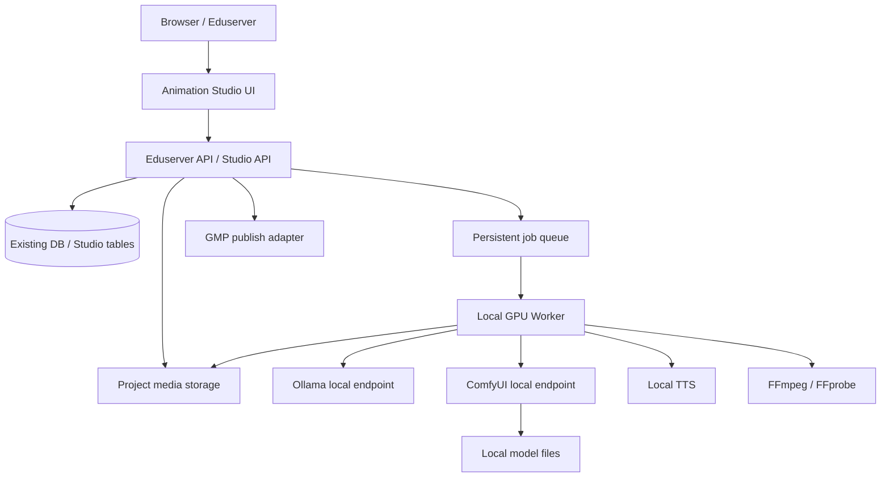

# Architecture

## Principle: local-first control plane + optional GPU worker

HG680P is the low-resource control plane. A capable local workstation is the generation plane. Both may be on LAN; secure remote access to Eduserver does not imply exposing AI engines publicly.

## Services
- `eduserver-web`: existing application; do not replace.
- `animation-api`: preferably a module in existing backend; standalone FastAPI only if repo architecture calls for it.
- `animation-worker`: lightweight queue orchestration on server or GPU workstation. Generation worker must be on GPU workstation.
- `ollama`: local LLM service on worker.
- `comfyui`: image/video workflows on worker.
- `redis`: optional persistent queue/cache if existing infrastructure does not provide one; HG680P resource limits.
- `postgres`: reuse existing DB; do not create a competing database without a reason.
- `ffmpeg`: local assembly/rendering worker.
- `storage`: project assets on HDD; model files on GPU workstation storage.

## Network
- UI/API on Eduserver host.
- GPU worker initiates secure connection or uses LAN/VPN; avoid public inbound GPU ports.
- ComfyUI and Ollama bind to private interface only; authentication/proxy required if crossing LAN.
- Cloudflare Tunnel routes only public Eduserver endpoints. It does not route raw engine ports.
- Local-only inference policy: reject provider URLs outside configured private/local allowlist; no cloud fallback.

## Worker protocol
Worker polls or receives jobs from API over authenticated channel. A job includes `job_id`, `project_id`, scene/asset IDs, task type, workflow key, validated inputs, output directory, cancellation token and callback credentials. Worker reports heartbeat, progress, logs (redacted), outputs and engine metadata.

## Engine adapters
- `LLMAdapter`: Ollama chat/generate, JSON schema validation, retries, model capability.
- `ComfyAdapter`: workflow templates, submit prompt, poll history/status, cancel where supported, retrieve output files.
- `TTSAdapter`: Piper (or selected local engine) generation.
- `RenderAdapter`: FFmpeg commands generated from validated timeline; never execute arbitrary user-supplied command strings.
- `GMPAdapter`: publish/unpublish and metadata using existing GMP contract.

## Failure and recovery
- Job state persisted before dispatch.
- Worker heartbeat with lease timeout.
- Stale `processing` job becomes `retryable`/`failed` after checking output and engine state.
- Idempotency key for dispatch and publish.
- Retry only transient failures; limit attempts and record error category.
- Temporary files cleaned on failure according to retention policy.

## Resource controls
- One video generation job at a time by default per worker.
- Configurable concurrency and VRAM safety limit.
- Check disk free space before render.
- Avoid storing duplicate large outputs; use asset references and hashes.
- HG680P containers receive CPU/memory limits; generation is never scheduled to HG680P.
